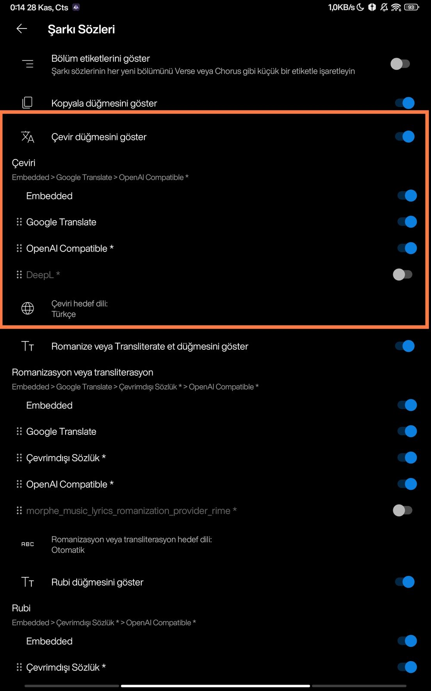
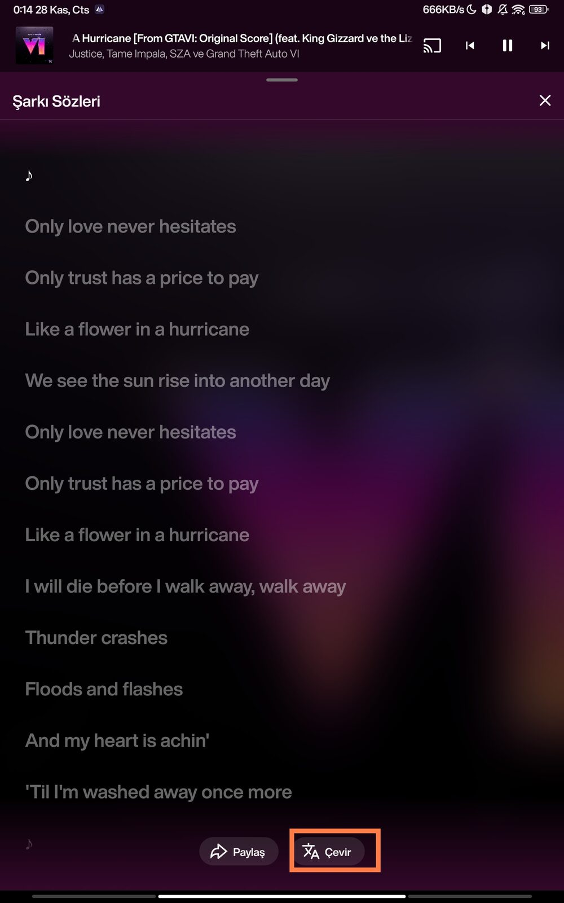
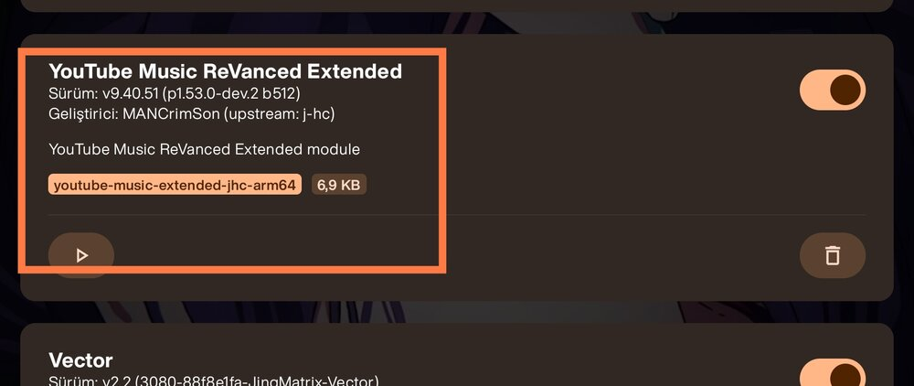
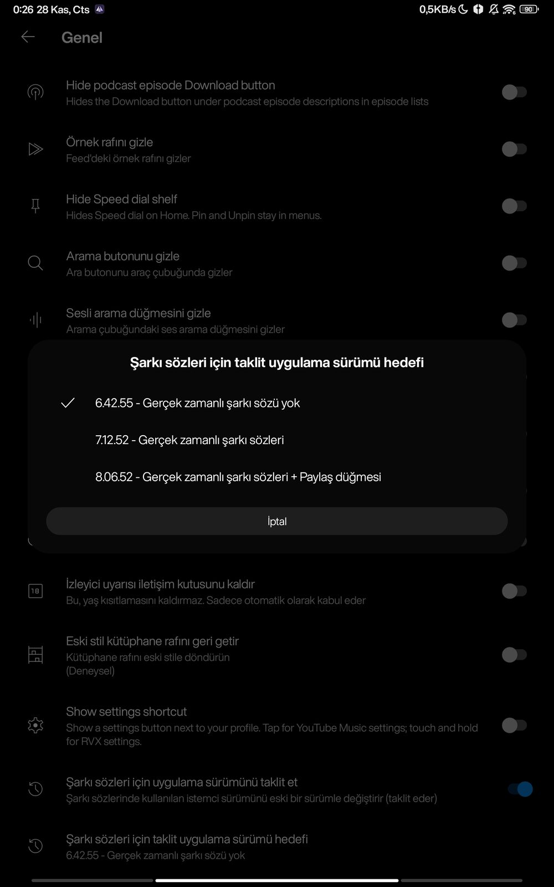
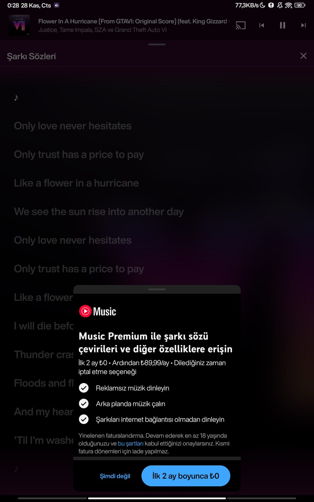

### Type

Error at runtime

### Tools used

Morphe CLI (prebuilt root module — see Additional context)

### Application

YouTube Music **9.40.51** (arm64-v8a) — ReVanced Extended, patches **v1.53.0-dev.2**

### Bug description

On YouTube Music 9.40.51 the **third-party lyrics panel never attaches**. The lyrics screen always stays the **native** one, showing only the two stock buttons **Share** and **Translate**. The custom toolbar (Copy / Translate / Romanize / Refresh) never appears, so none of the Third-party lyrics settings have any effect.

Tapping the native **Translate** button opens the **"Get lyrics translations and more with Music Premium"** subscription sheet instead of translating. The account has **no Music Premium subscription** — this is the stock upsell. The native sheet itself displays the English lyrics fine, so there is text to translate; the problem is that the custom panel (which does the client-side translation) is never installed.

**Steps to reproduce**

1. Install the YouTube Music ReVanced Extended 9.40.51 arm64-v8a build (patches v1.53.0-dev.2).
2. In RVX Settings → Lyrics, enable the third-party lyrics options: show Copy / Translate / Romanize / Ruby buttons; translation providers **Embedded**, **Google Translate**, **OpenAI Compatible** (DeepL off); translation target language **Turkish**.
3. Play a track that has lyrics (test track: **Justice — Flower In A Hurricane [From GTAVI: Original Score]**) and open the lyrics sheet.
4. Observe the sheet, then tap **Translate**.

**Expected:** the third-party lyrics panel replaces the native sheet, its own toolbar appears, and Translate renders the Turkish translation through the configured provider (no Premium involved).

**Actual:** the native sheet stays (only Share + Translate). Tapping Translate opens the Music Premium paywall. No crash; the rest of the app works normally. Reproduced repeatedly (see the two paywall screenshots taken minutes apart).

**Things already tried**

- The **"Spoof app version for lyrics"** option is enabled. Changing its target (6.42.55 / 7.12.52 / 8.06.52) and reopening the app does not bring up the custom panel — the native sheet and the Premium upsell still appear.
- App language is **Turkish**; the issue is present with it.

**Screenshots**

1. Lyrics settings — translation enabled, target language Turkish:

2. The lyrics sheet actually shown — native layout, only Share + Translate:

3. Tapping Translate → Music Premium subscription sheet:

4. Installed module / version (`youtube-music-extended-jhc-arm64`, v9.40.51 / p1.53.0-dev.2 b512):

5. "Spoof app version for lyrics" setting and its targets:

6. After adjusting the spoof target and reopening — the Premium sheet still appears:

### Error logs

No crash and no exception — the app behaves normally, it just keeps the native lyrics panel. I can capture `logcat` with debug logging enabled if that helps; let me know what to filter for.

### Solution

9.40.51 is the recommended stable target and `LyricsPanelInstaller` in v1.53.0-dev.2 already contains the tabbed-panel support (`bottom_sheet_tabbed_view`, `onTabSelected`, `findLyricsTabbedView`), so this does not look like the old "tabbed panel not supported" case. On this device neither path installs the panel:

- the engagement-panel path (Litho filter + `modern_title` / `panel_content`, with the identity-based fallback), and
- the tabbed path (`TabbedViewTabSelectedFingerprint` → `onTabSelected` → `isLyricsTabSelected`, which matches the localized selected tab title).

Possible directions to investigate:

- The 9.40.51 lyrics sheet may be a layout variant that exposes neither the engagement-panel anchors nor a selected, title-matching tab (e.g. a full-height sheet where the tab strip/title is not present or not `isSelected()`), so both install paths bail out.
- Locale: the app runs in Turkish; `isLyricsTabSelected` / `isLyricsTitle` compare against the localized lyrics title. If the on-screen heading/tab text differs from the resource string in this configuration, the match would fail. Happy to test with the app language set to English to help isolate this.

If the custom panel cannot be installed on a given layout, it would also be nice to hide/neutralise the native Translate action so users are not pushed to the Premium sheet.

### Additional context

- Build provenance: prebuilt **root module** from [MANCrimSon/YouTube-ReVanced-Extended release 512](https://github.com/MANCrimSon/YouTube-ReVanced-Extended/releases/tag/512), asset `youtube-music-revanced-extended-module-v9.40.51-arm64-v8a.zip`. That release is built with **lavinhoque33/revanced-patches v1.53.0-dev.2** via Morphe CLI 2.4.0, so the patches are exactly this repo's.
- Same symptom reported upstream: anddea/revanced-patches#1835 (open). The native Translate button being server-side Premium-gated is also described in MorpheApp/morphe-patches#2916. The tabbed-panel work (MorpheApp/morphe-patches#4267) is already present in this patch version, yet the panel still does not attach here.
- Everything else in the build works; only the lyrics panel injection / translation is affected.

### Device Environment

- arm64-v8a Android phone, rooted with **SukiSU Ultra** (KernelSU-based) + **Vector v2.2** (Zygisk framework).
- App language: **Turkish**; region: Turkey.
- No Music Premium subscription on the account.

### Acknowledgements

- [x] This issue does not reproduce on unpatched apps (the native panel + Premium upsell is the stock behavior; the bug is that the patch's replacement panel never appears).
- [x] This issue is not a duplicate of an existing bug report in this repository.
- [x] I did not use any settings marked as `Experimental Flags`.
- [x] I have patched the APK myself (using a prebuilt module produced from this repo's exact patches — see Additional context).
- [x] I have chosen an appropriate title.
- [x] All requested information has been provided properly.
- [x] I have written the title and contents in English.
